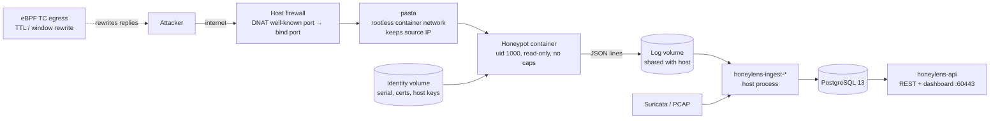

# HoneyLens Sensor 1.0

HoneyLens is a deception sensor for **IT and OT/ICS networks**. One host runs a fleet of
**43 honeypots** — from SSH, HTTP, RDP and databases to Modbus, S7comm, DNP3, BACnet and
emulated FortiGate, PAN-OS, NetScaler, SharePoint, Kubernetes and LLM-assistant appliances — captures every
interaction, classifies it, enriches it with threat intelligence and exposes the result
through a REST API and a web dashboard.

The 1.0 line runs on **Rocky Linux 9 / RHEL 9** with **Python 3.12** and is an installable
package (`honeylens`) rather than files copied into `/opt/sensor`. Every honeypot is a
**rootless container** (podman + systemd quadlets). The honeypots never touch the database:
they write JSON events to a shared volume and a host-side ingest moves them into
PostgreSQL. An **eBPF** layer rewrites TCP fingerprints on egress so the decoys look like the
devices they imitate even at the packet level.

Licensed under **AGPL-3.0-or-later**.

---

## Table of contents

- [What it does](#what-it-does)
- [Architecture](#architecture)
- [Components](#components)
- [Honeypots](#honeypots)
- [Port model](#port-model)
- [Security model](#security-model)
- [Requirements](#requirements)
- [Installation](#installation)
- [Configuration](#configuration)
- [Operations](#operations)
- [Migrating from 0.9](#migrating-from-09)
- [Fingerprint deception (eBPF)](#fingerprint-deception-ebpf)
- [Development](#development)
- [Project status](#project-status)
- [Documents](#documents)
- [License](#license)

---

## What it does

| Capability | How |
|---|---|
| **Deception** | 43 honeypots as separate containers, generated from one manifest. Vendor decoys (FortiGate, PAN-OS HTTPS + SSH, NetScaler, SharePoint, Kubernetes, WAGO PLC, nginx, an LLM assistant) keep a persistent **identity** — serial numbers, certificates, host keys — so a rescan sees the same device. |
| **Capture** | Every request, login attempt, payload and credential is recorded as a JSON event with raw bytes preserved. Optional PCAP capture and Suricata alerts are ingested alongside. |
| **Classification** | Rule-based attack classifier (text and binary detectors, custom rules reloaded at runtime), severity scoring, JA3/JA4+ TLS fingerprinting, MITRE ATT&CK mapping, ICS-aware verdicts for OT protocols. |
| **Threat intelligence** | GeoIP, scanner exclusions (known research scanners), OSINT enrichment (AbuseIPDB, VirusTotal, Shodan, GreyNoise, OTX, Censys…), CIRCL, APT attribution, attacker profiling, MITM detection on the local segment. |
| **AI analysis** | Optional triage and deep analysis of events and attackers through a local Ollama model or an external Claude API, with prompt-injection canaries. Event AI is off by default. Attacker hunting also supports the Nous API with a configurable model and saved usage metadata. |
| **Fingerprint deception** | eBPF TC classifier rewrites TTL and TCP window on outgoing packets per honeypot, so a PLC decoy answers like a PLC and a Windows decoy like Windows. |
| **API and dashboard** | FastAPI REST API and a self-contained web dashboard on port 60443 (TLS), with session/Argon2 or LDAP authentication and an admin panel that can start and stop honeypots. |
| **Forwarding** | SIEM forwarders for Loki, Splunk, Elastic and generic webhooks; optional publishing of reports. |
| **OT attack simulation** | `honeylens-ics-attack` exercises the ICS decoys with real protocol operations — **read-only by default**, state-changing and DoS operations only behind explicit flags. |

---

## Architecture



**Data flow in five steps**

1. Traffic reaches the host on the protocol port. A protocol port ≥ 1024 is bound and
   published under that same number, so nothing stands in between (mqtt 1883 is literally
   1883); a port < 1024 is remapped and the host firewall DNATs it to the honeypot's
   **bind port** (see [Port model](#port-model)).
2. **pasta**, podman's rootless network, forwards the connection into the container and
   **preserves the attacker's source IP** — the event records the real address.
3. The honeypot answers and writes one **JSON line per event** to `/opt/logs/...` inside the
   container, which is a volume shared with the host. The container holds no database
   credentials and no `.env`.
4. A host-side **ingest** reads the volume, normalises the record, classifies it, extracts
   attack patterns and ICS verdicts, runs canary checks and inserts everything into
   PostgreSQL. Writers and cleanup coordinate through persistent lock files. The honeypot
   ingest removes only successfully consumed data; incomplete or rejected records are retained;
   vendor ingests (FortiGate, PAN-OS) track a byte position instead.
5. The **API** serves the dashboard and REST endpoints from the database. Analysis
   daemons (AI, profiler, MITM detector) work on the same tables.

The single source of truth for *what is a honeypot, on which port, with which identity* is
`honeylens.honeypots.manifest`. From that one file come the CLI (`honeylens-hp <name>`),
the container image per honeypot, the systemd quadlet, the firewalld DNAT script and the
eBPF fingerprint map.

---

## Components

Every component is a console entry point installed with the package.

| Command | Role | Runs as |
|---|---|---|
| `honeylens-hp` | Run one honeypot (container `CMD`); `--list` the manifest; `--quadlets` generate systemd units | container / operator |
| `honeylens-api` | REST API + web dashboard, TLS on 60443 (self-signed cert generated on first start; `--no-tls` for a reverse proxy) | user service |
| `honeylens-ingest-honeypot` | Daemon: honeypot JSON → PostgreSQL (classification, attack patterns, ICS verdicts, canaries) | user service |
| `honeylens-ingest-fortigate`, `honeylens-ingest-paloalto` | Vendor-format ingests, one-shot — run from a systemd timer | user timer |
| `honeylens-ingest-ebpf`, `honeylens-ingest-suricata` | eBPF dissection events and Suricata `eve.json` → PostgreSQL | service |
| `honeylens-pcap-manager` | PCAP rotation, compression (zstandard) and export outbox | service |
| `honeylens-migrate` | Idempotent schema migrations `0001`–`0009` | operator |
| `honeylens-ai-analyzer`, `honeylens-profiler`, `honeylens-mitm-detector` | Analysis daemons (AI triage, attacker profiling, MITM detection) | service |
| `honeylens-db-archive` | Retention: move old events to monthly archive tables, optional CSV export | timer |
| `honeylens-ttl-deception` | eBPF TTL/window rewrite loader (needs root and BCC) | system service |
| `honeylens-ttl-profiler` | Measure the host's own TTL/window baseline | diagnostics |
| `honeylens-ics-attack` | OT attack simulator against the ICS decoys, read-only by default | operator |
| `honeylens-migrate-sensor` | Migrate an existing 0.9 sensor in place, dry-run by default | operator |
| `honeylens-geoip` | GeoIP lookup from the shell | operator |
| `honeylens-blog-publisher` | Optional report publishing | opt-in |

Admin account bootstrap: `python -m honeylens.tools.setup_admin --username <name> --email <mail> --generate`.

---

## Honeypots

All 43 decoys, generated from the manifest. **Protocol port** is what the attacker targets
and what the event records; **bind port** is what the container actually listens on (see
[Port model](#port-model)). A single number means the two are the same — the decoy binds the
real service port directly, with no remapping, no firewall rule and no privilege (mqtt 1883,
rdp 3389); an arrow means the port was remapped because it is below 1024 or the host owns it.
Decoys with an **identity** keep serials/certificates/host keys in a persistent volume.

### Network and application decoys

| Name | Protocol port → bind | Identity | Emulates |
|---|---|---|---|
| ssh | 22 → 30022 | – | SSH server (banner + auth capture) |
| telnet | 23 → 30023 | – | Telnet |
| ftp | 21 → 30021 | – | FTP |
| smtp | 25 → 30025 | – | SMTP |
| http | 80 → 30080 | – | Generic HTTP |
| nginx | 8443, 8000 | nginx | nginx TLS tarpit + cleartext site |
| ldap | 389 → 30389 | – | LDAP |
| smb | 445 → 30445 | – | SMB |
| rsync | 873 → 30873 | – | rsync |
| afp | 548 → 30548 | – | AFP |
| rdp | 3389 | – | RDP |
| vnc | 5900 | – | VNC |
| adb | 5555 | – | Android Debug Bridge |
| javarmi | 1099 | – | Java RMI |
| memcached | 11211 | – | memcached |
| redis | 6379 | – | Redis |
| mqtt | 1883 | – | MQTT broker |
| mysql | 3306 | – | MySQL |
| postgres | 5432 → 35432 | – | PostgreSQL (bound high — the sensor's own database owns 5432) |
| oracle | 1521 | – | Oracle TNS |
| cassandra | 9042 | – | Cassandra |
| elasticsearch | 9200 | – | Elasticsearch |
| dahua | 37777 | – | Dahua DVR |
| k8s | 6443, 8080, 10250, 10255, 2379, 8001, 30000 | – | Kubernetes API, kubelet, etcd, dashboard |
| llm | 3080 | llm | Corporate LLM assistant (OpenAI-compatible API; captures prompt injection) |
| llm-tls | 443 → 30443 | llm | Same decoy behind TLS |
| fortigate | 10443, 20443 | fortigate | FortiGate management + SSL-VPN portal |
| paloalto | 4443, 6082, 6080 | paloalto | PAN-OS management + captive portal |
| paloalto-ssh | 2200 | paloalto | PAN-OS SSH (same device as `paloalto`) |
| netscaler | 443 → 50443, 80 → 50080 | netscaler | NetScaler Gateway portal, HTTP/TLS capture and exploit-shape classification |
| sharepoint | 443 → 51443, 80 → 51080 | sharepoint | On-prem SharePoint Server (ToolShell / Picker / `_api` surfaces, MachineKey honeytoken, anonymous exploit surfaces) |
| honeypot | 21…9300, 8080, 8443 → 40021…49300, 48080, 48443 | honeypot | Legacy monolith (many services in one process) |

### OT / ICS decoys

| Name | Protocol port → bind | Identity | Emulates |
|---|---|---|---|
| modbus | 502 → 30502 | – | Modbus/TCP PLC |
| s7comm | 102 → 30102 | – | Siemens S7 (COTP/ISO-TSAP) |
| dnp3 | 20000 | – | DNP3 outstation |
| iec104 | 2404 | – | IEC 60870-5-104 |
| enip | 44818 | – | EtherNet/IP (CIP) |
| fins | 9600 | – | Omron FINS |
| bacnet | 47808/udp | – | BACnet/IP |
| opcua | 4840 | – | OPC UA |
| fox | 1911 | – | Niagara Fox |
| profinet | 34964/udp | – | PROFINET DCP |
| wago | 8090 | wago | WAGO PLC web interface |

`honeylens-hp --list` prints the live table from the manifest.

---

## Port model

A decoy binds its port as the unprivileged `honeylens` user (uid 1000) inside a rootless
container — no `CAP_NET_BIND_SERVICE`, no `net.ipv4.ip_unprivileged_port_start`, no setuid
helper. That is the only reason any port moves at all: **a port below 1024 cannot be bound,
a port at or above 1024 needs nothing and is kept as it is.** The manifest resolves it
deterministically:

| Case | Bind port | Firewall rule | Example |
|---|---|---|---|
| Protocol port ≥ 1024 | **the protocol port itself** | none needed | mqtt 1883, rdp 3389, dnp3 20000 |
| Protocol port < 1024 | `30000 + port` | DNAT | ssh 22 → 30022 |
| Port the sensor host itself owns (its PostgreSQL 5432, its API 60443) | `30000 + port` | DNAT | postgres 5432 → 35432 |
| Legacy monolith | `40000 + port` for every port, so it can stand beside the individual decoys | DNAT | https 443 → 40443 |

Three consequences:

- **Most decoys need no firewall rule and no privilege whatsoever.** `hp-mqtt` publishes
  `1883:1883` and serves MQTT on the real service port as an ordinary user account; so do
  rdp, vnc, redis, mysql, dnp3, iec104, enip, opcua and the rest of the ≥ 1024 set. Root
  appears nowhere in this path — neither on the host nor in the container.
- **The host firewall does the DNAT only where the two numbers differ.**
  `honeylens-hp --quadlets` writes a ready `firewalld-forwards.sh` containing exactly those
  rules — a decoy on a port ≥ 1024 gets no line in it.
- **The event always records the protocol port** (22, not 30022). The container receives
  `HONEYLENS_PORT_MAP` from the manifest and the sink translates the bound port back, so the
  classifier and the ICS context see the real service port. For a decoy that was never
  remapped the translation is the identity, and `dst_port` is the bound port already.

Do not forward external port 22 straight to the host — that is the host's own sshd. Forward
it to 30022.

---

## Security model

The sensor is built to be exposed to the internet, so the decoys are hardened against the
traffic they invite.

- **Rootless containers under a service account.** podman runs as the unprivileged `sensor`
  account, never as a person's login; inside the container the process is `honeylens`
  (uid 1000) mapped to that account's uid on the host (`UserNS=keep-id`), so volumes are
  owned by a normal user on both sides. The account matters operationally as well as for
  least privilege — see [Installation](#installation).
- **Minimal capabilities.** Every quadlet sets `DropCapability=ALL`, `NoNewPrivileges=true`,
  `ReadOnly=true` with a tmpfs `/tmp`. A honeypot cannot open raw sockets, escalate or write
  to its own image.
- **No secrets in containers.** The container gets only the manifest variables and
  `TZ=UTC`. No `.env`, no database credentials. The database is reachable only from the host
  on `127.0.0.1`.
- **Identity outside the image.** Certificates, serial numbers and host keys live in a
  per-decoy identity volume created on first start. An image rebuild never changes what an
  attacker sees — a changed serial is a honeypot tell.
- **Source IP preserved.** pasta keeps the attacker's address through the container boundary;
  no masquerading, no lost attribution.
- **Secrets never enter the repository.** Configuration comes from `.env` (mode `0600`,
  warned about if looser) or environment variables; `.env.example` is the contract of
  expected keys, always without values. `.creds*` and `.env*` are ignored by git.
- **Security gate in CI and hooks.** gitleaks (full history), pip-audit on the pinned lock,
  semgrep, bandit, ruff, mypy and a CycloneDX SBOM run on every commit and push; a scanner
  that fails to run is treated as a failure, not as "no findings".
- **Passwords** are hashed with Argon2id (PBKDF2 fallback); sessions are server-side tokens
  with a per-user concurrent-session limit; LDAP/LDAPS authentication validates certificates
  by default.
- **The dashboard's own responses are hardened too**, and two of the choices are worth
  knowing because a scanner will argue with them:
  - Every response, denials included, carries `Content-Security-Policy`,
    `Strict-Transport-Security`, `X-Frame-Options: DENY`, `X-Content-Type-Options`,
    `Referrer-Policy`, `Permissions-Policy`, `Cross-Origin-Opener-Policy` and
    `Cross-Origin-Resource-Policy`. The CSP allows only the origins the pages actually
    load from — Leaflet via cdnjs, basemap tiles, EPSS lookups — and closes `object-src`,
    `frame-src`, `base-uri`, `form-action` and `frame-ancestors`.
  - `script-src` still carries `'unsafe-inline'`, so the CSP does **not** stop injected
    inline script. The dashboards keep behaviour in inline `onclick=` attributes, which no
    nonce covers, and a nonce in `script-src` would disable `'unsafe-inline'` and break all
    of them at once. `webui.shared.generate_csp_nonce()` is the second half of that job and
    is deliberately uncalled until those handlers move to `addEventListener`.
  - **`Cross-Origin-Embedder-Policy` is deliberately not set.** `require-corp` blocks every
    cross-origin subresource that does not opt in, which is the map library and its tiles —
    it would blank the hunting map. A test asserts the header stays absent.
  - There are no anti-CSRF form tokens, and none are needed: the session cookie is
    `SameSite=Strict` and `HttpOnly`, so a cross-site POST carries no session at all.
    Scanners flag the missing token without reading the cookie policy.

---

## Requirements

| Component | Version | Notes |
|---|---|---|
| OS | Rocky Linux 9 / RHEL 9 (x86_64); Rocky Linux 10.2 pilot | Rocky 9 is the production baseline; the measured Rocky 10 core pilot is not yet a full-fleet sign-off |
| Python | 3.12 | AppStream alongside system 3.9 on Rocky 9; the system interpreter on Rocky 10 |
| podman | ≥ 4.4 (quadlets); 5.x tested | rootless, with pasta |
| PostgreSQL | 13 on Rocky 9; 16.15 in the Rocky 10 pilot | on the same host, `127.0.0.1` only |
| firewalld | any | DNAT well-known → bind ports; open the bind ports |
| Suricata (optional) | 7.0 from EPEL | `eve.json` ingest |
| BCC / bcc-tools (optional) | distro packages | required only for `honeylens-ttl-deception` |
| Ollama or Anthropic API (optional) | – | AI analysis, off by default |

Why 3.12: eight of the nine CVE fixes in our dependency set are unreachable on Python 3.9 —
the highest version 3.9 can install *is* the vulnerable one. 3.12 is the newest Python in
Rocky 9 AppStream. Note that the RHEL 9 `python3.12` stream has a published retirement date
(April 2027).

---

## Installation

The steps below set up a complete sensor under a **dedicated unprivileged service account**
called `sensor`, which owns the tree, the state directory and every unit. You log in as
yourself with passwordless `sudo` for the few system-level actions (packages, firewall,
linger, subuid) and run the rest as `sensor`.

The service account is not a formality. Installing the stack into a human's home couples the
sensor to that login: the home can be relocated or `ProtectHome`d by a hardened system
service, at which point rootless lingering silently stops working and the decoys only run
while somebody holds an SSH session. We debugged exactly that in the field, and the event
rate was a fifteenth of what it should have been with nobody logged in.

### 1. System packages

```bash
sudo dnf install -y python3.12 python3.12-pip python3.12-devel podman postgresql-server \
    whois iproute-tc openssl
sudo postgresql-setup --initdb && sudo systemctl enable --now postgresql

# the service account that owns and runs the sensor
sudo useradd --system --create-home --shell /bin/bash sensor
sudo loginctl enable-linger sensor          # user units start at boot, with nobody logged in
grep -q '^sensor:' /etc/subuid || sudo usermod \
    --add-subuids 362144-427679 --add-subgids 362144-427679 sensor
sudo -u sensor podman system migrate        # picks up the new id ranges
```

Rootless podman needs the subuid/subgid ranges; without them every container fails to start
with `lchown ...: invalid argument`, which does not name the cause. Pick a range that does not
overlap an existing entry in `/etc/subuid` on that host — do not copy the numbers above
blindly. `podman system migrate` is required only if podman already ran as `sensor` before the
ranges existed; it is harmless otherwise.

Run everything from here on as that account (`sudo -u sensor -i`, or `machinectl shell
sensor@`). `sudo -u sensor` without `-i` keeps your own cwd, which `sensor` usually cannot
read, so commands fail with `cannot chdir`.

Command-line tools the sensor shells out to at runtime (install them or features fail
silently): **`whois`** — Team Cymru IP→ASN lookup in the keyless OSINT enrichment, without
it attacker profiles get no ASN; **`iproute-tc`** (`tc`, `ip`) — the eBPF TTL/window
fingerprint deception attaches its TC filter with these; **`openssl`** — honeypots that need
a certificate (K8s, the monolith) generate a self-signed one on first start. `iproute-tc` is
a separate package on Rocky/RHEL 9 (split out of `iproute`).

Create the database and user (PostgreSQL 13, local only), then put the credentials in
`.env` (see [Configuration](#configuration)).

### 2. Package

```bash
git clone <this repository> honeylens && cd honeylens
python3.12 -m venv .venv
.venv/bin/pip install -c requirements.txt .
```

`requirements.txt` is a lock compiled **on Rocky 9 with Python 3.12** (`make lock`), so the
installed versions are exactly the ones that passed the security gate. The install is not
editable: after changing source, run `pip install -c requirements.txt .` again.

### 3. Configuration and schema

```bash
mkdir -p ~/honeylens-state/{hp-logs,identity,ingest}
install -m 600 .env.example ~/honeylens-state/.env   # then fill in DB_*, API_*, …
export HONEYLENS_ENV_FILE=~/honeylens-state/.env
.venv/bin/honeylens-migrate                            # applies 0001–0009, idempotent
python -m honeylens.tools.setup_admin --username admin --email you@example.org --generate
```

### 4. Honeypot images and units

```bash
TAG=1.0.0 containers/honeypot/build.sh               # all 43 images (or list names)
.venv/bin/honeylens-hp --quadlets ~/.config/containers/systemd \
    --state-dir ~/honeylens-state --image-tag 1.0.0
systemctl --user daemon-reload                        # as `sensor`; linger was enabled in §1
```

One `Containerfile` builds every image (`--build-arg HONEYPOT=<name>`); the dependency
layer is shared, so after the first image the rest build in seconds. Images are
`localhost/honeylens/hp-<name>:<tag>`.

Before starting decoys with an identity, make sure their volume directories exist
(`~/honeylens-state/identity/<identity>`); podman does not create bind-mount sources.
The PAN-OS decoy expects an initialised identity (serial, certificates, templates) in its
volume — see the notes in the manifest.

### 5. Start the fleet

```bash
for unit in hp-ssh hp-http hp-modbus hp-nginx hp-k8s; do
  systemctl --user start "$unit" || break
done
```

Start containers sequentially on hosts with limited RAM to avoid Podman startup timeouts.

Then the host-side services (`honeylens-api`, `honeylens-ingest-honeypot`, and timers for
`honeylens-ingest-fortigate` / `honeylens-ingest-paloalto`) as `systemd --user` units with
`Environment=HONEYLENS_ENV_FILE=…` and `Environment=INGEST_STATE_DIR=…`. The two vendor-ingest
pairs ship ready to copy:
[`honeylens-ingest-fortigate.service`](containers/systemd/honeylens-ingest-fortigate.service) /
[`.timer`](containers/systemd/honeylens-ingest-fortigate.timer) and
[`honeylens-ingest-paloalto.service`](containers/systemd/honeylens-ingest-paloalto.service) /
[`.timer`](containers/systemd/honeylens-ingest-paloalto.timer).

Two deployment steps are easy to miss and both fail silently:

- **The PAN-OS decoys need their identity first.** Run
  [`scripts/init_paloalto_honeypot.sh`](scripts/init_paloalto_honeypot.sh) before starting
  `hp-paloalto` / `hp-paloalto-ssh`; without it they exit 1 and, under `Restart=always`, restart
  forever instead of reporting a failure.
- **The vendor ingests need their log paths in `.env`** (`FORTIGATE_LOG_FILE`,
  `PALOALTO_LOG_FILE`, `PALOALTO_SSH_LOG_FILE`), pointing at the **host** side of the log mount.
  Unset, they read `/var/log/…`, report `0 processed` and exit successfully, so the decoy runs
  with no events in the database and no error. Only these two decoy families need a dedicated
  ingest — the rest write through `sink.py` into the directory `honeylens-ingest-honeypot`
  already drains.

### 6. Firewall

Open the **bind ports** you deploy in firewalld and DNAT the well-known ports onto them:

```bash
sudo firewall-cmd --permanent --add-port=30022/tcp --add-port=8443/tcp   # …
sudo firewall-cmd --reload
sh ~/.config/containers/systemd/firewalld-forwards.sh   # generated DNAT rules
```

The dashboard is then at `https://<host>:60443/` (self-signed certificate on first start).

---

## Configuration

Configuration is read through one loader (`honeylens.env`): the `.env` file **wins over the
process environment** — the file on the sensor is the source of truth, a unit-level variable
is the exception. Search order: `HONEYLENS_ENV_FILE`, `./.env`, `/opt/honeylens/.env`,
`/opt/sensor/.env` (0.9 location, kept until the migrator retires it).

Key groups (the full contract, always without values, is [`.env.example`](.env.example)):

| Group | Keys |
|---|---|
| Database | `DB_NAME`, `DB_USER`, `DB_PASSWORD`, `DB_HOST`, `DB_PORT`, pool sizes |
| API / TLS | `API_HOST`, `API_PORT`, `API_TLS_PORT` (60443), `TLS_CERT_DIR`, `TLS_*` |
| Logs and ingest | `HONEYPOTNG_LOG_DIR`, `FORTIGATE_LOG_FILE`, `PALOALTO_LOG_FILE`, `INGEST_STATE_DIR` (must be an environment variable, not only `.env`) |
| Capture | `INTERFACE`, `PCAP_DIR`, `EVENTS_JSON`, `EBPF_*`, `DECEPTION_*`, `IGNORE_*` |
| Authentication | `SESSION_*`, `LDAP_*` (`LDAP_ALLOW_INSECURE_TLS` defaults to false) |
| Intelligence | `GEOIP_DB_PATH`, `OSINT_*_KEY`, `CIRCL_ENABLED`, `SCANNER_EXCLUSIONS_ENABLED`, `WHITELIST_*` |
| AI | `AI_PROVIDER`, `AI_ANALYSIS_ENABLED`, `USE_EXTERNAL_AI`, `NOUS_*`, `ANTHROPIC_API_KEY`, `OLLAMA_*`, `ATTACK_KB_*` |
| Hunting | `PROFILER_AUTO`, `PROFILER_BATCH_SIZE`, `PROFILER_INTERVAL`, `PROFILER_AI_PROVIDER`, `PROFILER_NOUS_MODEL`, `NOUS_API_KEY` |
| Forwarding | `SIEM_FORWARDERS_JSON`, `BLOG_*` |
| Retention | `DB_ARCHIVE_DIR`, `DB_ARCHIVE_DAYS`, `DB_ARCHIVE_EXPORT`, `DB_ARCHIVE_CLEANUP`, `BACKUP_PASSWORD` |

Honeypot **ports are not configured in `.env`** — the manifest owns them. An operator
environment variable (e.g. `HP_MODBUS_PORT`) still outranks the manifest for one unit when
needed.

---

## Operations

### Attacker hunting

Apply migration `0009` and enable the profiler unit from
[`containers/systemd/honeylens-profiler.service`](containers/systemd/honeylens-profiler.service).
Bulk hunt requests enter a durable queue; the worker processes them before automatic
IP discovery, retries failures and saves OSINT history and AI assessments. Event counts
remain unique when an event matches several attack patterns.

For Nous-backed hunting set `PROFILER_AI_PROVIDER=nous`, `NOUS_API_KEY` and
`PROFILER_NOUS_MODEL=qwen/qwen3-30b-a3b-instruct-2507` in the host's protected `.env`.
Failed AI calls preserve the last successful assessment. ThreatFox requires
`OSINT_THREATFOX_KEY`; missing credentials or failed feeds are not negative evidence.
Keep local key files such as `.nouresearch` out of Git and container build contexts.
See [hunting operations](docs/hunting-operations.md) for configuration, rollout and
NetScaler verification steps.

Event triage and deep analysis can use the same protected Nous key. Set
`AI_PROVIDER=nous`, `USE_EXTERNAL_AI=true`, and optionally override
`NOUS_TRIAGE_MODEL` or `NOUS_DEEP_MODEL`. Install the project with its `openai` extra
and enable [`containers/systemd/honeylens-ai-analyzer.service`](containers/systemd/honeylens-ai-analyzer.service).
The default Nous model for both stages is `qwen/qwen3-30b-a3b-instruct-2507`.

When `BLOG_ENABLED=true` and `BLOG_AUTO_PUBLISH_PROFILE=true`, each completed attacker
profile is published or updated through the configured `BLOG_URL`. Blog failures are
logged without rolling back the profile or blocking the hunting queue.

The API and legacy database callers use per-process connection pools. Each checkout
has its own lease: `close()` returns it once, clears the transaction and session state,
and cannot release a later checkout of the same underlying connection.

### Routine operations

- **Status**: `systemctl --user list-units 'hp-*'`, `podman ps`, `honeylens-hp --list`. The
  API's `/honeypots/health` and the admin panel show the same units and can start/stop them.
- **Ingest cadence**: the honeypot ingest polls every 30 s and truncates consumed data; the
  vendor ingests are one-shot and belong on a 30 s timer. If `INGEST_STATE_DIR` is not
  writable the vendor ingest re-reads the whole log every run — it warns loudly.
- **Retention**: `honeylens-db-archive` moves events older than `DB_ARCHIVE_DAYS` into
  monthly archive tables (clamped to the cutoff, so the current month is never skipped) and
  can export CSV.gz.
- **Logs**: honeypot containers log to journald (`journalctl --user -u hp-<name>`); events
  are in the shared volume only until ingested. The nginx TLS decoy is a deliberate tarpit —
  a client that does not complete the handshake produces no event, by design.
- **Rebuild after a source change**: `pip install -c requirements.txt .` on the host and
  `containers/honeypot/build.sh <names>` for the images, then restart the units.
- **Identity**: never delete `identity/<name>`; back it up with the database.

---

## Migrating from 0.9

Existing 0.9 sensors (flat files in `/opt/sensor`, root systemd units, Python 3.9) are
migrated **in place** — the host and its PostgreSQL stay, only the installation changes
shape. `honeylens-migrate-sensor` is **dry-run by default**:

```bash
sudo .venv/bin/honeylens-migrate-sensor --old-root /opt/sensor \
    --state-dir ~/honeylens-state --new-env ~/honeylens-state/.env          # plan
sudo .venv/bin/honeylens-migrate-sensor --apply …                            # do it
sudo chown -R sensor: ~sensor/honeylens-state   # named, not "$USER" — sudo may not be sensor
```

What it does: copies honeypot **identities bit for bit** (SHA-256 verified — a regenerated
serial would be a fingerprint) honouring 0.9 path overrides, translates `.env` (secrets 1:1,
`API_PORT` → 60443, new keys added, honeypot port variables dropped, unknown keys carried
**and reported**), and writes the new `.env` with mode `0600`. Schema and units are delegated
to `honeylens-migrate` and `honeylens-hp --quadlets`. Stop the 0.9 units before `--apply`
and take a `pg_dump` first. Design and rationale: [`docs/decision-migrator.md`](docs/decision-migrator.md).

---

## Fingerprint deception (eBPF)

Reconnaissance tools guess the OS from the TTL and TCP window of the first reply. A PLC
decoy answering with a Linux fingerprint is an obvious honeypot. `honeylens-ttl-deception`
attaches a **TC egress classifier** (BCC) that rewrites TTL and window per source port:
`plc` profile for the OT decoys, `windows` for LDAP/RDP/SMB, `linux` for the rest. The
port→profile map is generated from the manifest (`ttl_profile`), keyed on the protocol port,
and works through the container boundary and DNAT — measured end to end. It runs as a root
system service; everything else in the sensor is unprivileged.

---

## Development

```bash
make dev        # venv on 3.12 + dev dependencies + pre-commit hooks (refuses if not 3.12)
make all        # ruff, mypy, pytest, security gate — the same thing CI runs
make lock       # recompile requirements.txt in a Rocky 9 / Python 3.12 container
```

The gate must be green before a commit; hooks are never bypassed. Rules of the port from 0.9,
kept as invariants: **tests first** (the 0.9 golden tests were moved before the code they
guard), no `sys.path` bootstrap, no silent `except: pass`, timezone-aware datetimes only, a
PEP 594 audit per module. Every layer was reviewed for code smells by a second model and the
findings were fixed before merging.

Repository layout:

```
src/honeylens/
  honeypots/      manifest, CLI, sink, 43 decoys (ics/, nginx/, wago/ subpackages)
  ingest/         honeypot / fortigate / paloalto / ebpf / suricata ingests, pcap manager
  classification/ attack classifier, text & binary rules, scoring, JA3/JA4+
  intelligence/   OSINT, CIRCL, APT attribution, host recon, MITM, scanner exclusions
  analysis/       attacker profiler, AI analyzers
  routes/, webui/ REST routes and the dashboard
  auth/           users, sessions, Argon2, LDAP, admin panel
  db/             migrations 0001–0009
  ebpf/           TTL/window deception loader and profiler
  siem/           Loki, Splunk, Elastic, webhook forwarders
  tools/          operator CLIs (archive, migrator, OT attack simulator, …)
tests/            unit, regression and integration checks
containers/       one Containerfile for every honeypot image + build script
ci/               security gate, lock builder
docs/             plan, decision records, porting method
```

---

## Project status

`1.0.0.dev0`. The port from the 0.9 line is complete: all eight layers, the OT attack
simulator (Phase 4) and the migrator design and scaffold (Phase 5) are merged and have
been deployed on live hosts receiving internet traffic. A Rocky 10.2 pilot now validates
Python 3.12, PostgreSQL 16, the API, generic ingest and five rootless decoys. Full Rocky 10
fleet coverage, eBPF/Suricata integration, automated production cutover and image the edge hostming
remain open.

---

## Documents

- [`docs/hunting-operations.md`](docs/hunting-operations.md) — durable hunting, Nous AI, OSINT availability and safe ingest rollout
- [`docs/decision-containers.md`](docs/decision-containers.md) — every honeypot in a container, eBPF native, the silent risks
- [`docs/decision-honeypot-runtime.md`](docs/decision-honeypot-runtime.md) — non-root containers, port model, JSON sink
- [`docs/decision-migrator.md`](docs/decision-migrator.md) — in-place migration, identity preservation
- [`docs/deploy-behind-nginx.md`](docs/deploy-behind-nginx.md) — fronting a decoy with an nginx edge (SNI stream on 443, HTTP proxy on 80) without leaving a proxy fingerprint
- [`docs/ja3-ja4-fingerprinting.md`](docs/ja3-ja4-fingerprinting.md) — JA3/JA4 TLS fingerprinting: what each form captures and what it licenses
- [`docs/proposal-async-job-queue.md`](docs/proposal-async-job-queue.md) — proposal for an asynchronous job queue
- [`docs/deception-waf-canary.md`](docs/deception-waf-canary.md) — the passive WAF canary: what it claims to be, and the line it does not cross

---

## License

AGPL-3.0-or-later. See `LICENSE`.
